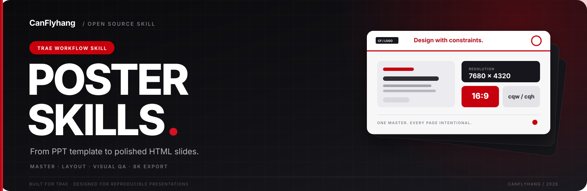
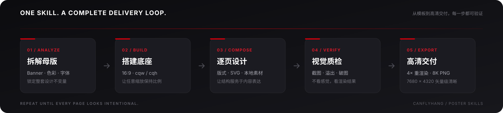
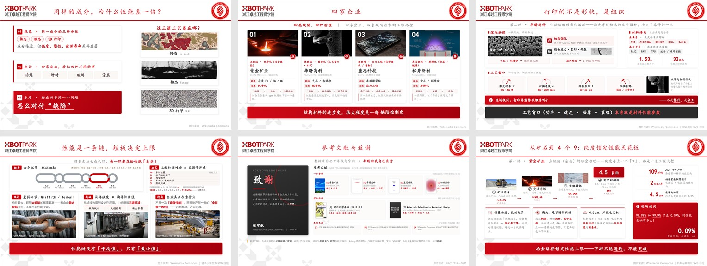
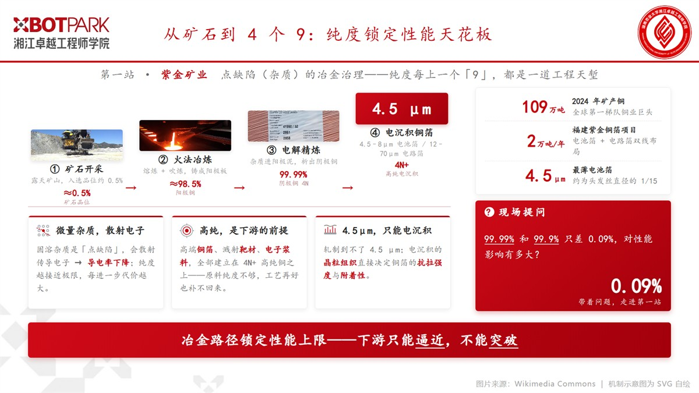
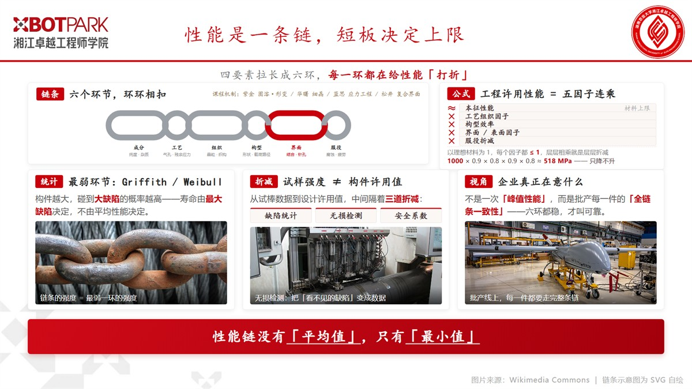

<p align="center">
  
</p>

<p align="center">
  <a href="https://github.com/CanFlyhang/poster-skills/stargazers">
    
  </a>
  <a href="https://github.com/CanFlyhang/poster-skills/commits/main">
    
  </a>
  <a href="./SKILL.md">
    
  </a>
  <a href="#8k-export">
    
  </a>
</p>

<p align="center">
  <strong>把 PPT 当前端项目做。</strong><br>
  从模板拆解到 8K 交付，一套可安装、可复用、可验证的 TRAE 网页幻灯片工作流。
</p>

<p align="center">
  <a href="#overview">Overview</a> ·
  <a href="#quick-start">Quick Start</a> ·
  <a href="#workflow">Workflow</a> ·
  <a href="#showcase">Showcase</a> ·
  <a href="#8k-export">8K Export</a> ·
  <a href="./SKILL.md">SKILL.md</a>
</p>

<br>

## Overview

**Poster Skills** 将高校、学院或企业 PPT 模板转化为可编辑、可等比缩放、可高清导出的 HTML 幻灯片。

它不是一组静态模板，而是一套交给 AI 执行的完整方法：**用母版锁定风格，用容器单位锁定比例，用逐页截图锁定质量，用高倍重渲染锁定清晰度。**

<table>
  <tr>
    <td width="50%">
      <strong>01 / MASTER FIRST</strong><br><br>
      先拆 Banner、色彩、字体与网格，再开始逐页设计。母版是不变量，不是每页重新猜测的建议。
    </td>
    <td width="50%">
      <strong>02 / RELATIVE BY DESIGN</strong><br><br>
      用 <code>cqw/cqh</code> 管理定位、尺寸、字号与间距。窗口缩小、投影放大，页面比例始终如一。
    </td>
  </tr>
  <tr>
    <td width="50%">
      <strong>03 / VISUAL QA</strong><br><br>
      代码不报错，不代表画面正确。每一页都经过真实渲染，检查溢出、遮挡、破图与异常换行。
    </td>
    <td width="50%">
      <strong>04 / TRUE 8K</strong><br><br>
      1920×1080 视口配合 4× 设备缩放，让浏览器重新绘制文字、CSS 与 SVG，而不是拉伸截图。
    </td>
  </tr>
</table>

<br>

## Why Poster Skills

| 常见做法 | Poster Skills |
|---|---|
| 拖拽对齐，反复微调 | 用网格与相对单位建立可复现的版式 |
| 每页让 AI 自由发挥 | 用母版约束不变量，用内容决定页面结构 |
| 相邻页面重复“左图右文” | 根据流程、因果、对比、层级选择表达结构 |
| 图片依赖临时链接 | 素材本地化，概念图优先使用内联 SVG |
| 代码运行成功就交付 | 每页截图核验，修改后再次复核 |
| 放大低分辨率图片 | 4× 设备缩放重渲染，输出 7680×4320 PNG |

> **核心不是“让 AI 画一页 PPT”，而是建立一条从设计约束到交付验收的完整链路。**

<br>

## Workflow

<p align="center">
  
</p>

完整的八步执行规范位于 [SKILL.md](./SKILL.md)，可归纳为五个阶段：

1. **Analyze**：提取模板中的 Banner、LOGO、色彩、字体与网格。
2. **Build**：建立 16:9 容器、`cqw/cqh` 尺寸系统和正文母版。
3. **Compose**：根据内容选择卡片、阶梯、链条、放射、矩阵等结构。
4. **Verify**：使用无头浏览器逐页截图，检查真实渲染结果。
5. **Export**：以 4× 设备缩放导出 8K 图片，整理源文件与本地素材。

<br>

## Quick Start

### Prerequisites

- [TRAE](https://www.trae.ai/) 或兼容 Workspace Skills 的编辑器
- Git
- Windows 下可选 Microsoft Edge，用于无头截图与 8K 导出

### Install

在项目根目录执行：

**Windows / PowerShell**

```powershell
New-Item -ItemType Directory -Force .trae\skills
git clone https://github.com/CanFlyhang/poster-skills.git .trae\skills\poster-skills
```

**macOS / Linux**

```bash
mkdir -p .trae/skills
git clone https://github.com/CanFlyhang/poster-skills.git .trae/skills/poster-skills
```

也可以手动将本仓库中的 `SKILL.md` 复制到：

```text
your-project/.trae/skills/poster-skills/SKILL.md
```

### Invoke

安装后，用自然语言描述模板、内容和交付要求：

```text
请使用 poster-skills，根据我提供的高校 PPT 参考图制作 12 页网页汇报：
1. 保持 Banner、校徽、主色和标题位置一致；
2. 使用 16:9 与 cqw/cqh，保证任意窗口下等比缩放；
3. 根据每页内容选择不同且合适的版式；
4. 图片本地化，概念图使用内联 SVG；
5. 每页完成后截图质检，最后导出 8K PNG。
```

更聚焦的调用方式：

```text
请使用 poster-skills 修复 007.html 的模块遮挡。
只调整出问题的模块，保持母版和其他内容不变，修改后重新截图验证。
```

<br>

## Layout System

页面比例的技术核心只有几行：

```css
/* 幻灯片容器：保持 16:9，并启用容器查询尺寸单位。 */
.slide {
  width: min(100vw, calc(100vh * 16 / 9));
  aspect-ratio: 16 / 9;
  position: relative;
  overflow: hidden;
  container-type: size;
}

/* 页面元素：所有版式尺寸相对容器计算。 */
.title {
  position: absolute;
  top: 6.5cqh;
  left: 4cqw;
  font-size: 2.5cqw;
}
```

在 1920×1080 画布中：

| 单位 | 实际尺寸 | 用途 |
|---|---:|---|
| `1cqw` | 19.2px | 宽度、左右定位、字号、横向间距 |
| `1cqh` | 10.8px | 高度、纵向定位、模块间距 |

**关键约束**：`container-type: size` 必须设置在幻灯片容器上，页面元素才能正确使用 `cqw/cqh`。

<br>

## Showcase

以下图片来自该工作流的真实课程汇报实践，不是概念效果图。

<p align="center">
  
</p>

<p align="center">
  <sub>同一套母版，不同的信息结构：对比、卡片、流程、链条、文献与数据页。</sub>
</p>

<table>
  <tr>
    <td width="50%">
      
    </td>
    <td width="50%">
      
    </td>
  </tr>
  <tr>
    <td align="center"><sub>递进关系：用阶梯表达工艺路径。</sub></td>
    <td align="center"><sub>因果关系：用 SVG 链条表达性能折减。</sub></td>
  </tr>
</table>

<br>

## 8K Export

使用 Edge 无头模式，将 1920×1080 视口按 4× 设备比例重新渲染：

```powershell
$edge = "C:\Program Files (x86)\Microsoft\Edge\Application\msedge.exe"
New-Item -ItemType Directory -Force export

& $edge --headless=new --disable-gpu --hide-scrollbars `
  --virtual-time-budget=6000 --window-size=1920,1080 `
  --force-device-scale-factor=4 `
  --screenshot="export/page.png" "file:///absolute/path/to/page.html"
```

输出尺寸：**7680 × 4320**。

这不是位图插值。浏览器会在更高设备比例下重新绘制文字、CSS 和 SVG，因此边缘依然锐利。

<br>

## Repository

```text
poster-skills/
├── SKILL.md                       # 完整 Skill：触发条件、规范、流程与验收
├── README.md                      # 项目说明与快速上手
└── docs/
    └── assets/
        ├── readme-hero.svg        # CanFlyhang 品牌头图
        ├── workflow.svg           # 五阶段工作流图
        ├── showcase-grid.jpg      # 多版式展示
        ├── showcase-ladder.jpg    # 阶梯页面案例
        └── showcase-chain.jpg     # 链条页面案例
```

<br>

## Use Cases

| 场景 | 可以获得什么 |
|---|---|
| 课程与研学汇报 | 统一学校模板、突出内容结构、准备备用 Q&A 页 |
| 论文与组会分享 | 图文混排、概念 SVG、参考文献可视化 |
| 项目路演 | 一致的品牌视觉、差异化页面、高清导出 |
| 企业内部分享 | 固定母版规范、可复用提示词、可审查的源文件 |
| 前端设计教学 | 用真实案例理解容器查询、网格和视觉质检 |

<br>

## Contributing

欢迎让这套 Skill 更好用，而不仅是更复杂。

可以贡献：

- 新的页面结构及其适用内容说明
- 更可靠的视觉检查清单
- macOS / Linux 浏览器导出示例
- 文案、翻译与使用案例
- 对现有流程的简化与纠错

建议流程：

1. Fork 本仓库并创建功能分支。
2. 保持 `SKILL.md` 的触发条件与执行步骤清晰。
3. 新增视觉素材时，同时检查尺寸、路径与 GitHub 渲染。
4. 提交 Pull Request，说明改动解决了什么问题。

<br>

## Support

如果这套方法帮你节省了排版时间，或让你的汇报更像一个完整作品，欢迎给仓库一个 Star。

<p align="center">
  <a href="https://github.com/CanFlyhang/poster-skills/stargazers">
    
  </a>
</p>

你的 Star 不会解锁任何功能，但会让这套方法被更多需要它的人看到。

<br>

---

<p align="center">
  <strong>CanFlyhang</strong><br>
  <sub>Make every page intentional.</sub><br><br>
  <sub>Designed for TRAE · Built with HTML / CSS / SVG</sub>
</p>
